# NetworkWalks B083 — Week 4  
## Mediroza General Hospital Penetration Testing Project


This repository documents my **Week 4 penetration testing project** completed as part of the **NetworkWalks Cybersecurity Internship — Batch B083**.

The assessment was conducted against the **Mediroza General Hospital training environment**. The objective was to follow a complete black-box testing workflow: reconnaissance, application testing, access validation, protected-file analysis, metadata review, sensitive-data discovery, risk assessment, and professional reporting.

> **Important:** This project was completed in an authorized educational environment. The techniques documented here must not be used against systems without explicit permission.

---

## Project Objectives

The project was divided into four main milestones:

- **Milestone 1 — Initial Access:** identify weaknesses in the target web application and obtain access to protected patient reports.
- **Milestone 2 — Data Extraction:** analyze and recover access to the three protected PDF reports.
- **Milestone 3 — Critical Data Exposure:** investigate metadata and server-side exposure that led to confidential staff and shareholder information.
- **Milestone 4 — Reporting:** document the full assessment, findings, evidence, risk levels, and remediation recommendations.

---

## Scope

| Item | Details |
|---|---|
| Target | `https://medirozahospital.com` |
| Assessment Type | Black-box penetration test |
| Environment | Authorized training lab |
| Main Platform | Kali Linux |
| Duration | Week 4 internship project |
| Primary Deliverable | Professional penetration testing report |

Testing remained limited to the project scope defined by NetworkWalks.

---

## Tools Used

The project involved a mix of reconnaissance, web testing, PDF analysis, and data review tools:

- Kali Linux
- Browser-based manual testing
- Burp Suite Community Edition
- Nmap
- WhatWeb
- WAFW00F
- John the Ripper
- `pdf2john`
- NetworkWalks Hash Calculator
- NetworkWalks Password Cracker
- `qpdf`
- ExifTool
- Standard Linux utilities

Not every tool produced a reportable finding. Only evidence that directly supported the final attack chain was selected for the main documentation.

---

# Attack Chain Overview

The assessment showed how several weaknesses could be chained together rather than treated as isolated issues.

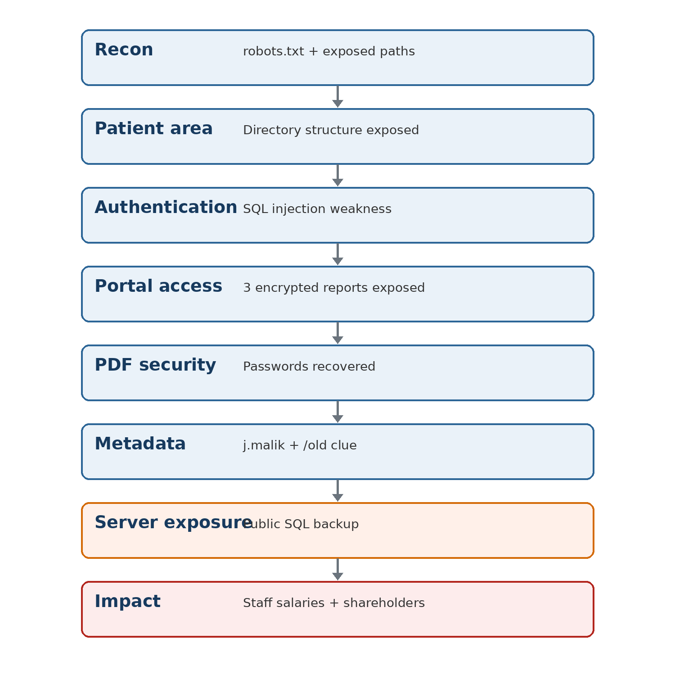

The main path was:

```text
Reconnaissance
      ↓
Exposed application directories
      ↓
Patient portal authentication weakness
      ↓
SQL injection / authentication bypass
      ↓
Access to encrypted patient reports
      ↓
Weak document passwords
      ↓
Sensitive PDF metadata
      ↓
Exposed /old/ directory
      ↓
Public database backup
      ↓
Staff salary and shareholder information
```

This chain was the most important outcome of the project because it demonstrated how a weakness at one layer could expose data at another.

---

# Milestone 1 — Reconnaissance and Initial Access

## 1. Reconnaissance

The first phase focused on understanding the public attack surface and identifying useful entry points.

### `robots.txt` Discovery

The target's `robots.txt` file exposed several internal paths, including the patient, staff, and old-content directories.

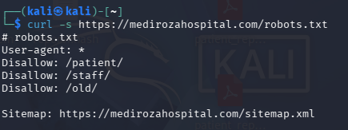

This was important because it immediately provided directories worth reviewing during the assessment.

### Exposed Patient Directory

The `/patient/` path allowed directory indexing and exposed the application structure.

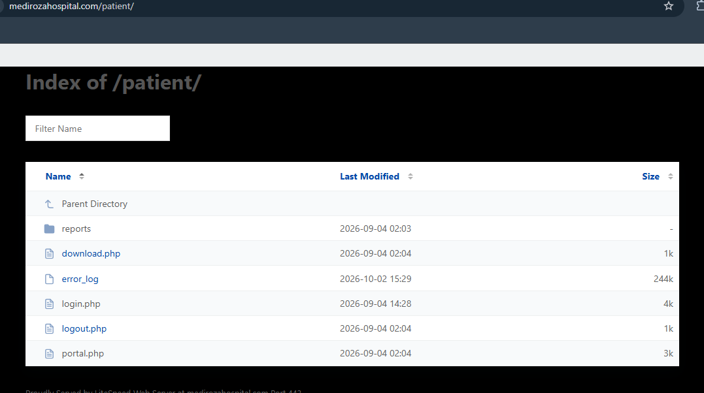

The listing revealed components such as:

- `reports/`
- `download.php`
- `error_log`
- `login.php`
- `logout.php`
- `portal.php`

This disclosure made the application structure easier to map and reduced the amount of guesswork required during testing.

---

## 2. Authentication Testing

The patient login page was tested for unsafe input handling.

### SQL Error Disclosure

Malformed input caused the application to return a raw MySQL error.

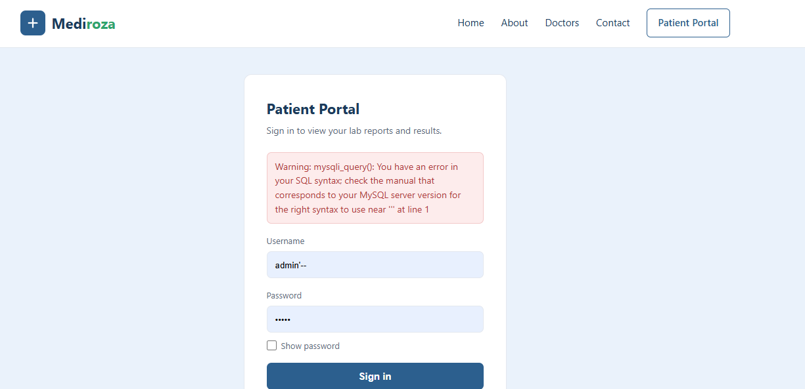

The database error indicated that user-controlled input was being handled unsafely inside the authentication query.

### Authentication Bypass Validation

Further testing confirmed that the login logic could be bypassed.

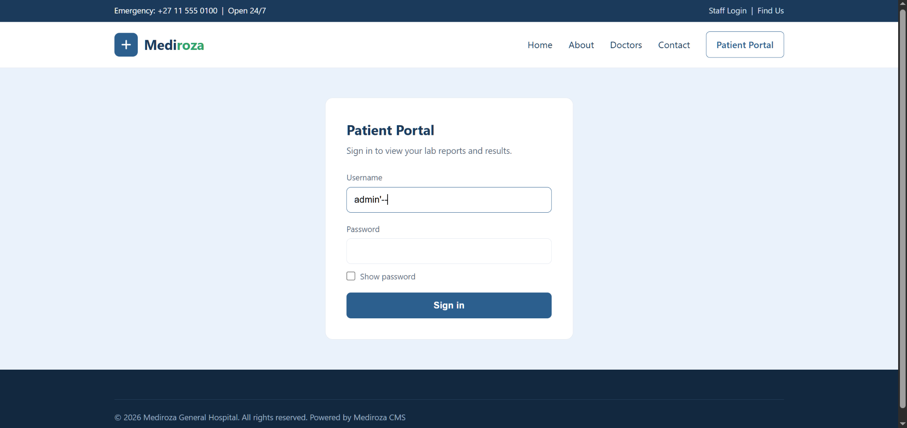

The successful test provided access to the restricted patient portal.

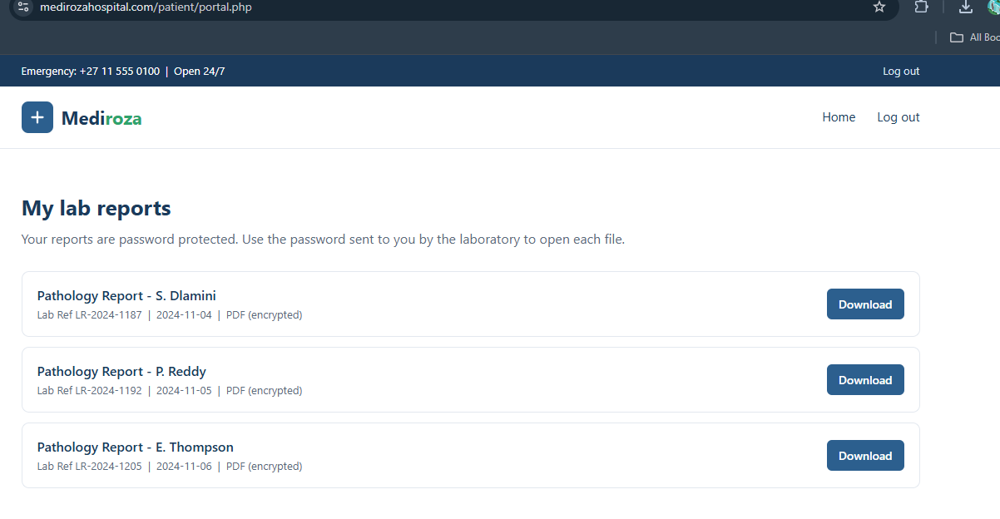

The portal exposed three encrypted pathology reports belonging to different patients.

### Retrieved Files

All three reports were downloaded for the next milestone.

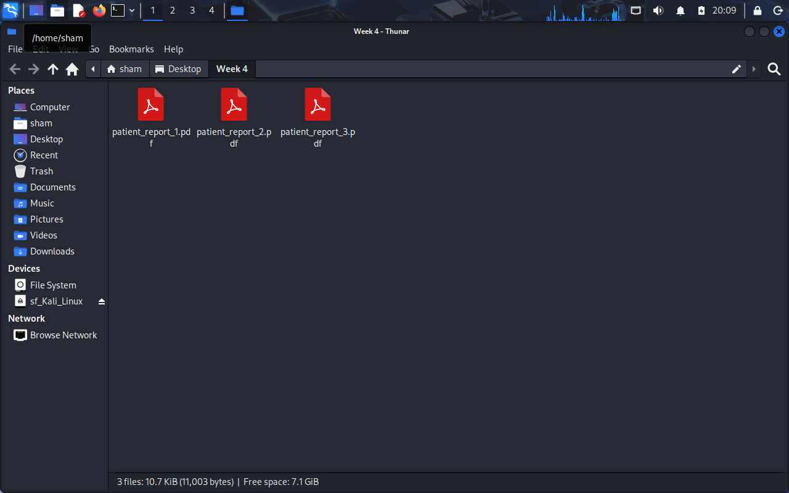

---

# Milestone 2 — Protected PDF Analysis

The retrieved files were password protected. The next stage was to determine whether the protection was strong enough to resist dictionary-based recovery.

## 1. Password Recovery — Report 1

The first report's PDF hash was extracted and tested using a wordlist-based approach.

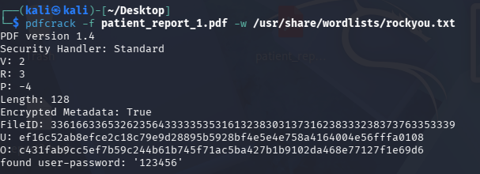

The password was recovered successfully, confirming that the document protection was weak.

## 2. Password Recovery — Reports 2 and 3

The same process was repeated for the remaining two reports.

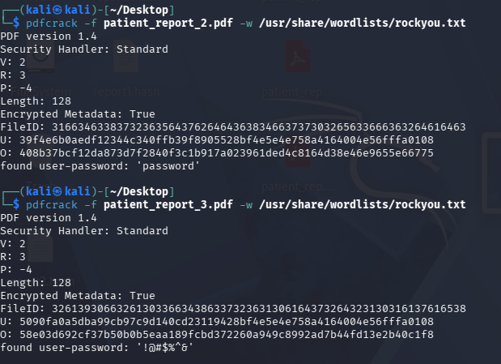

All three encrypted reports were successfully recovered.

This demonstrated that password protection alone was not an adequate control for confidential medical documents when weak or predictable passwords were used.

---

## 3. Verification of Recovered Reports

Each recovered password was validated by opening the corresponding report.

### Report 1

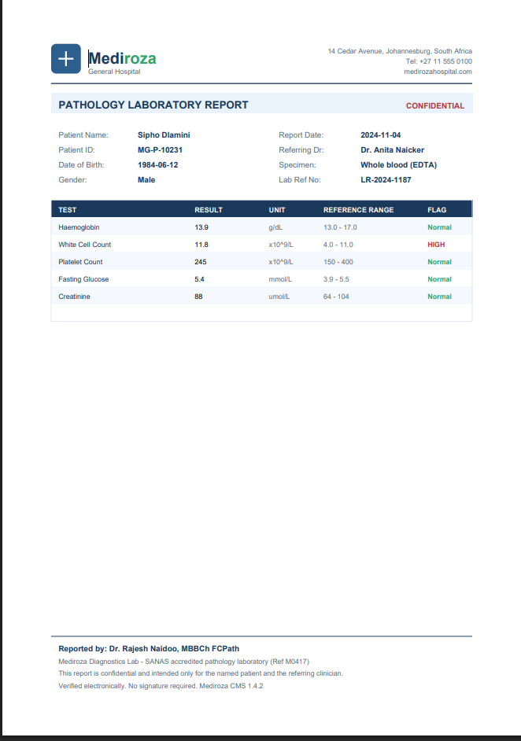

### Report 2


### Report 3

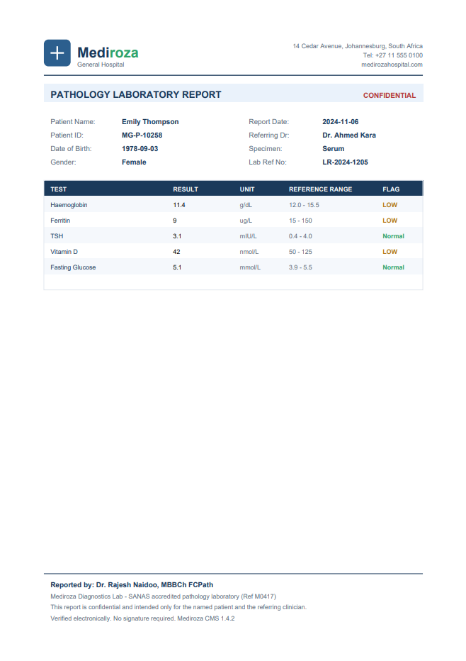

The goal of this step was verification only. The medical contents themselves were not required for the vulnerability analysis.

---

# Milestone 3 — Metadata and Critical Data Exposure

The third report was especially important because its metadata contained an internal clue that connected the patient-document exposure to a more serious server-side data leak.

## 1. Sensitive PDF Metadata

ExifTool was used to inspect the decrypted PDF.

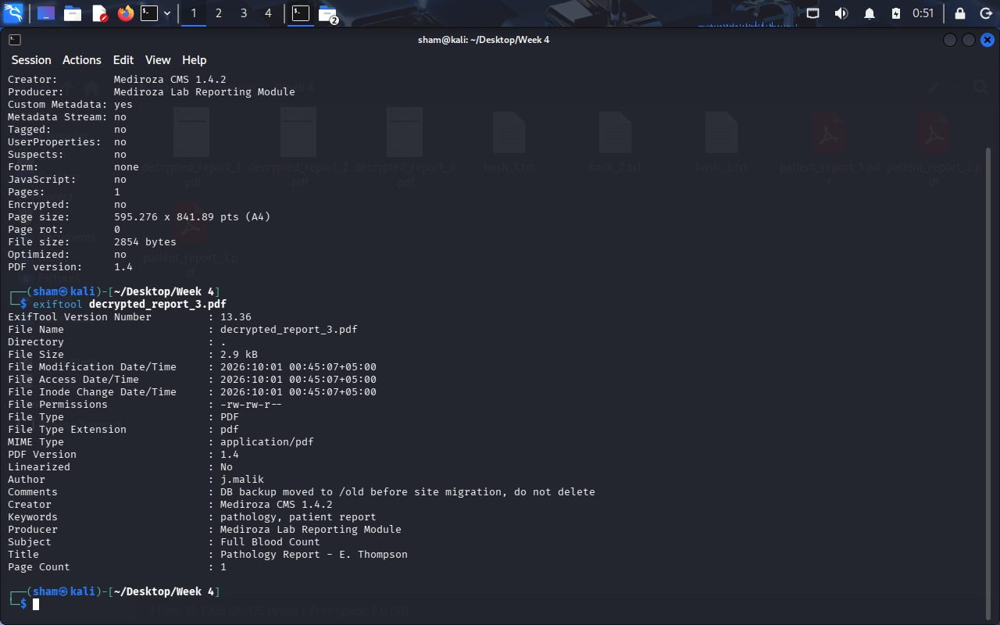

The metadata revealed:

- an internal author identifier
- an internal comment referring to a database backup
- a reference to the `/old/` directory

This showed why metadata sanitization is important before confidential documents are distributed.

---

## 2. Exposed `/old/` Directory

The `/old/` directory was then reviewed.

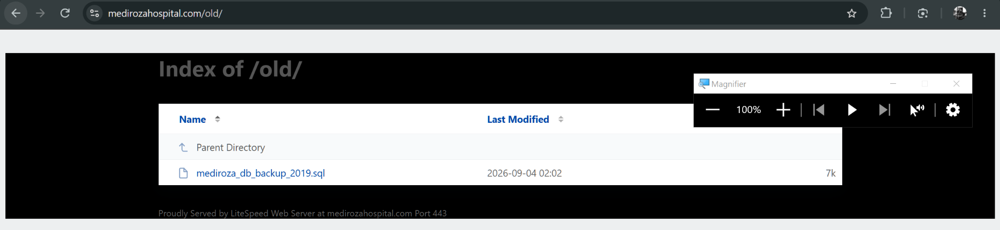

Directory indexing was enabled and a database backup file was publicly accessible.

---

## 3. Public Database Backup

The exposed backup identified itself as containing confidential staff and shareholder information.

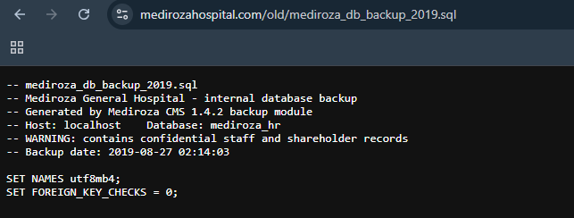

The backup contained structured database records that should never have been stored in a publicly accessible location.

---

## 4. Staff Salary Exposure

The `staff` table contained sensitive employee information including job roles, departments, and monthly salary data.

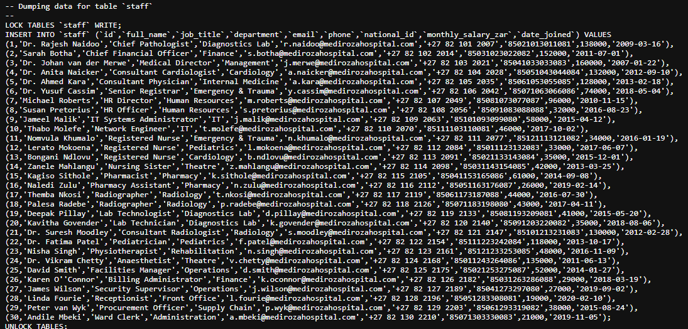

The database also contained additional personal fields. The project report focused only on the data required by the internship milestone instead of reproducing every exposed field.

---

## 5. Shareholder Data Exposure

The same backup also contained hospital shareholder records.

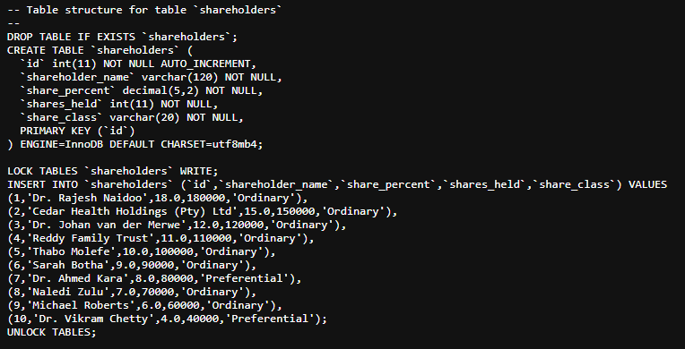

The exposed fields included:

- shareholder name
- ownership percentage
- shares held
- share class

This completed the final data-exposure milestone.

---

# Findings Summary

| ID | Finding | Risk |
|---|---|---|
| F-01 | Public directory listing under `/patient/` | Medium |
| F-02 | SQL injection in patient portal authentication | **Critical** |
| F-03 | Authentication bypass exposing confidential patient reports | **High** |
| F-04 | Weak password protection on patient PDF files | **High** |
| F-05 | Sensitive information stored in PDF metadata | Medium |
| F-06 | Public `/old/` directory and exposed database backup | **Critical** |
| F-07 | Confidential staff and shareholder data exposed in plain text | **Critical** |

## Overall Risk

**Critical**

The highest risk came from the ability to chain multiple weaknesses together. A single authentication issue ultimately led to access to protected documents, internal metadata, a forgotten server backup, and confidential organizational data.

---

# Remediation Recommendations

## F-01 — Directory Listing

- Disable directory indexing on production web directories.
- Use explicit index files where necessary.
- Review publicly reachable folders for unintended file exposure.
- Remove unnecessary logs and internal files from the web root.

## F-02 — SQL Injection

- Use parameterized queries or prepared statements.
- Never build SQL statements by directly concatenating user input.
- Apply server-side input validation.
- Suppress raw database errors from end users.
- Review all other database-backed forms for similar weaknesses.

## F-03 — Patient Report Access

- Enforce authorization checks on every file request.
- Store confidential reports outside the public web root.
- Require authenticated and authorized access before downloads.
- Avoid relying on hidden paths as an access-control mechanism.

## F-04 — Weak PDF Passwords

- Use strong, unique passphrases for protected files.
- Avoid dictionary words and common password patterns.
- Do not rely on PDF passwords as the main security boundary.
- Use application-level authorization and protected storage first.

## F-05 — Metadata Exposure

- Strip unnecessary metadata before distributing documents.
- Remove internal usernames, comments, paths, and infrastructure references.
- Add document sanitization to the publishing process.

## F-06 — Public Backup Exposure

- Never store database backups inside public web directories.
- Move backups to restricted storage.
- Disable directory listing.
- Encrypt sensitive backups.
- Apply strict filesystem permissions and retention controls.

## F-07 — Confidential Database Data

- Restrict access to staff and shareholder data.
- Encrypt sensitive data at rest.
- Remove outdated backup copies.
- Apply least-privilege access controls.
- Monitor access to sensitive administrative datasets.

---

# Key Lessons Learned

This project was useful because it showed that penetration testing is not only about finding one vulnerability.

The most important lesson was **attack chaining**.

A publicly visible path led to an application weakness.  
The application weakness led to confidential documents.  
The documents contained metadata.  
The metadata led to an old server directory.  
The old directory exposed a database backup.  
The backup exposed highly sensitive organizational information.

This made the project much closer to a realistic assessment than testing isolated vulnerabilities independently.

I also gained practical experience with:

- reconnaissance and attack-surface mapping
- web authentication testing
- SQL injection validation
- document password analysis
- John the Ripper
- PDF hash extraction
- metadata inspection
- directory-listing exposure
- sensitive-data review
- risk assessment
- evidence collection
- professional penetration testing documentation

---

# Repository Structure

```text
.
├── README.md
├── report/
│   └── Week4_Mediroza_Penetration_Testing_Report.pdf
└── screenshots/
    ├── 01-reconnaissance/
    │   ├── 01-robots-txt-discovery.png
    │   └── 02-patient-directory-listing.png
    │
    ├── 02-initial-access/
    │   ├── 01-sql-injection-error.png
    │   ├── 02-sql-injection-payload.png
    │   ├── 03-patient-portal-access.png
    │   └── 04-retrieved-pdf-files.png
    │
    ├── 03-pdf-recovery/
    │   ├── 01-pdf1-password-recovery.png
    │   ├── 02-pdf2-pdf3-password-recovery.png
    │   ├── 03-decrypted-patient-report-1.png
    │   ├── 04-decrypted-patient-report-2.png
    │   └── 05-decrypted-patient-report-3.png
    │
    ├── 04-data-exposure/
    │   ├── 01-pdf3-metadata-exposure.png
    │   ├── 02-old-directory-listing.png
    │   ├── 03-public-database-backup.png
    │   ├── 04-staff-salary-data.png
    │   └── 05-shareholder-data.png
    │
    └── 05-summary/
        └── 01-attack-chain.png
```

---

# Full Report

The complete professional report is available here:

[**Download / View the Week 4 Penetration Testing Report**](report/Week4_Mediroza_Penetration_Testing_Report.pdf)

The report contains the full methodology, evidence, detailed findings, risk ratings, impact analysis, and remediation plan.

---

# Internship Context

This repository is part of my cybersecurity portfolio developed during the **NetworkWalks Cybersecurity Internship — Batch B083**.

Previous internship work included:

- cybersecurity and pentesting lab setup
- Kali Linux networking and VirtualBox configuration
- password security and PDF analysis
- John the Ripper
- NetworkWalks password-cracking tools
- HexStrike MCP lab setup and AI-assisted security tooling

This Week 4 project brought those earlier skills together into a complete penetration testing workflow.

---

## Disclaimer

This repository documents an **authorized educational cybersecurity lab**.

All testing was performed only within the environment provided for the NetworkWalks internship. The information in this repository is intended for education, portfolio development, and defensive security learning.

Do not test systems you do not own or have explicit permission to assess.
